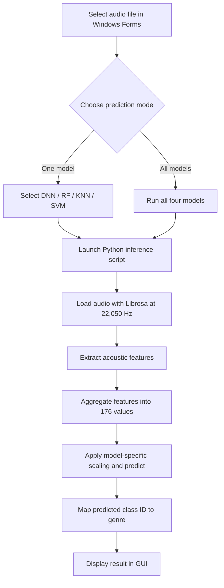
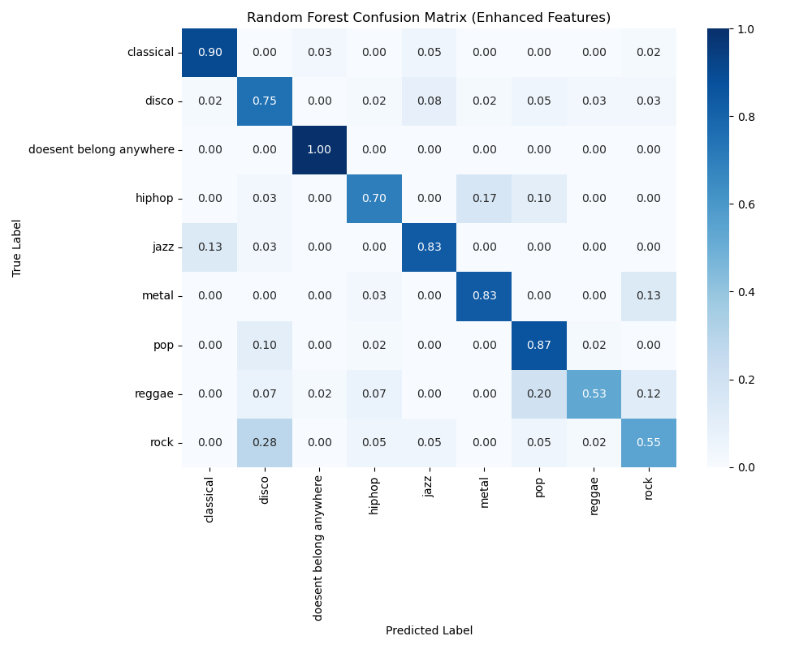
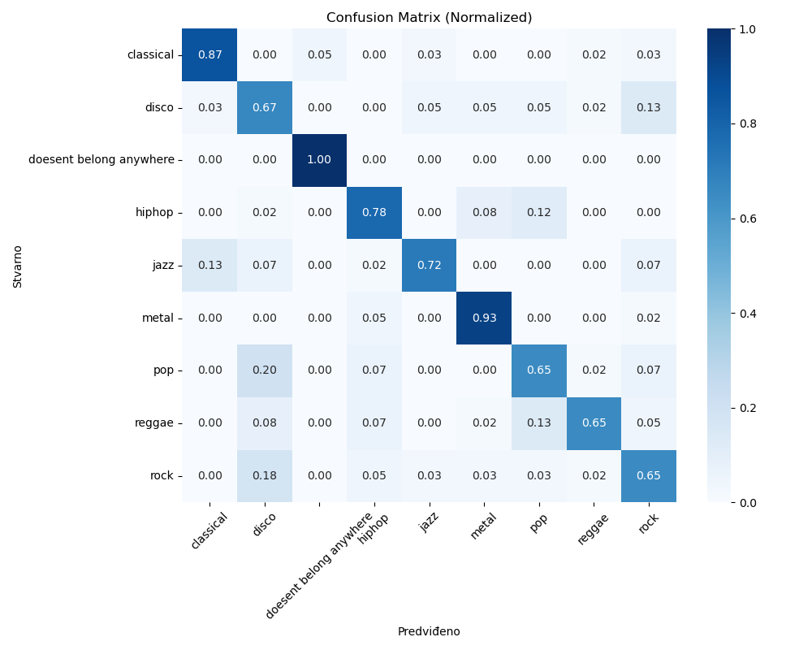
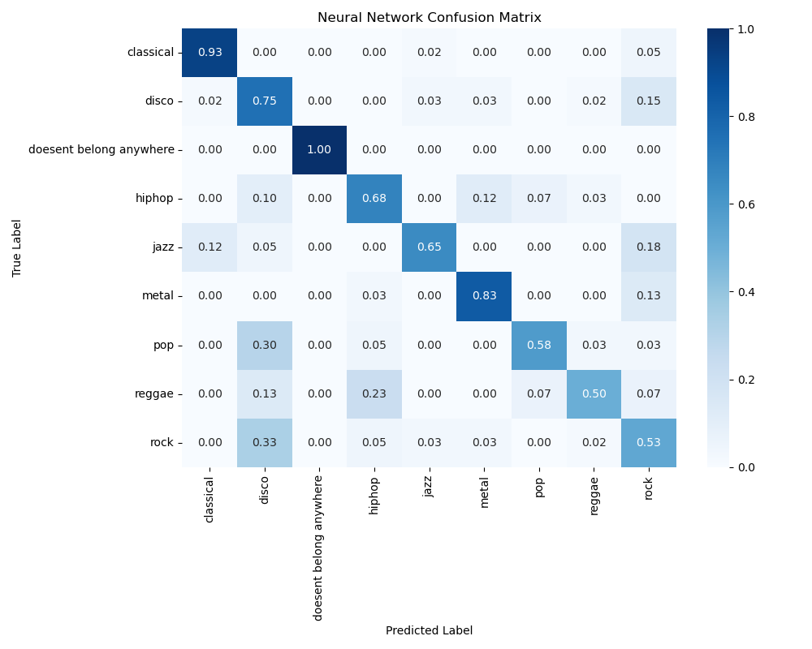
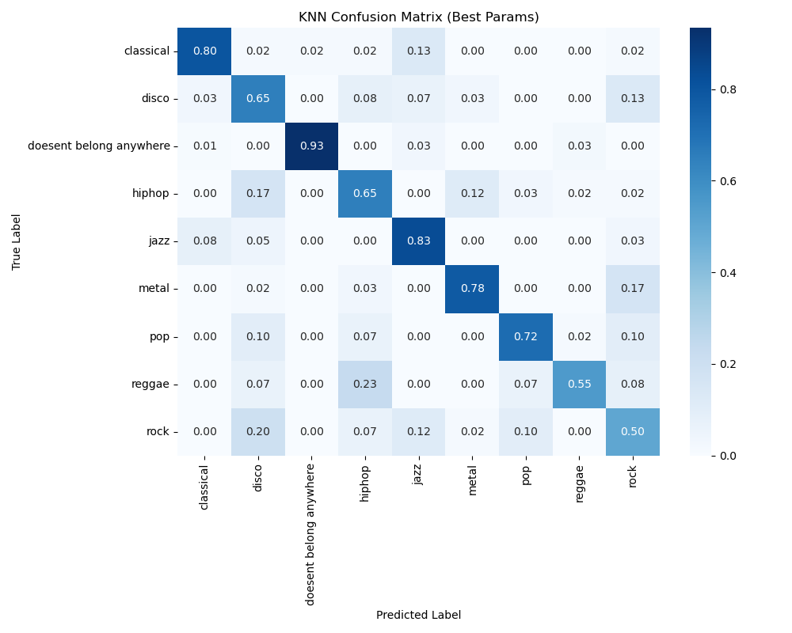

# Music Genre Classification

A desktop application for classifying audio clips into **nine classes** using four machine-learning models: **K-Nearest Neighbors (KNN)**, **Support Vector Machine (SVM)**, **Random Forest (RF)**, and a **fully connected deep neural network (DNN/FCN)**. The application combines a **C# Windows Forms** interface with a **Python** audio-analysis and inference pipeline.

The project was developed using a modified version of the **GTZAN** music genre dataset. Eight music genres were used, alongside an additional class containing artificially generated noise. The original 30-second recordings were divided into 5-second clips for model development.

## Features

- Load an audio file through the Windows Forms interface.
- Play and pause the selected audio using NAudio.
- Select an individual classifier (DNN, RF, KNN, or SVM).
- Run all four classifiers on the same audio file and view their predictions side by side.
- Extract acoustic features automatically at prediction time.

The GUI file picker lists `.mp3`, `.wav`, `.ogg`, and `.flac` files. Actual decoding support depends on the installed audio libraries and codecs.

## Technologies

| Component | Technology |
| --- | --- |
| Desktop application | C#, Windows Forms, .NET Framework 4.7.2 |
| Audio playback | NAudio 2.2.1 |
| Audio feature extraction | Python, Librosa, NumPy |
| Traditional ML | scikit-learn (KNN, SVM, Random Forest) |
| Neural network | TensorFlow / Keras |
| Model serialization | joblib, Keras `.keras` format |
| Evaluation and plots | scikit-learn, Matplotlib, Seaborn |

## Architecture



The GUI invokes Python via `System.Diagnostics.Process` and reads the script's standard output. It does **not** embed Python inside the C# process.

## Classes

The classifier predicts one of the following labels (as stored in `mappings.json`):

`classical`, `disco`, `doesn't belong anywhere`, `hiphop`, `jazz`, `metal`, `pop`, `reggae`, `rock`.

## Dataset and preprocessing

The experiments used a modified **GTZAN** dataset rather than the complete original 10-genre configuration. Original 30-second music recordings were split into shorter **5-second** segments. The training code reads precomputed features from `train_v3.json`, `validation_v2.json`, and `test_v2.json`.

The included `tt.py` script demonstrates how features are extracted from **already prepared audio files** in a directory of class-labelled subfolders and exported to a JSON file. It does not perform the original 30-second-to-5-second split, generate the noise samples, or create the train/validation/test partitions. Those preparation steps are not fully reproducible from the available scripts.

**The dataset is not included in this repository.** To retrain the models, you must provide compatible, properly split datasets, including the additional noise class. Keeping segments from the same original recording in a single partition is important to avoid leakage between training and evaluation.

### Acoustic feature extraction

Audio is loaded at **22,050 Hz**, using `n_fft = 2048`, `hop_length = 512`, and a nominal segment duration of **5 seconds**. Feature sequences are padded or truncated to a fixed length before statistical aggregation.

| Feature | Channels | Statistics per channel | Values |
| --- | ---: | ---: | ---: |
| MFCC | 13 | 5 | 65 |
| Chroma STFT | 12 | 5 | 60 |
| Spectral centroid | 1 | 5 | 5 |
| Spectral bandwidth | 1 | 5 | 5 |
| Zero-crossing rate | 1 | 5 | 5 |
| Spectral contrast | 7 | 5 | 35 |
| Estimated tempo | 1 | — | 1 |
| **Total** | | | **176** |

The five statistics are **mean, standard deviation, maximum, minimum, and median**. All four final training scripts use the same feature-group order: MFCC → chroma → spectral centroid → spectral bandwidth → ZCR → spectral contrast → tempo.

> **Inference detail:** the Python prediction scripts apply a 5-second frame limit to the loaded input, but estimate tempo from the loaded signal before that truncation. For results consistent with the intended training inputs, use 5-second audio clips.

## Models

| Model | Configuration |
| --- | --- |
| **KNN** | 13 neighbors; Manhattan distance; distance-weighted voting |
| **Random Forest** | 200 trees; maximum depth 20; `max_features='sqrt'`; `random_state=123` |
| **SVM** | RBF kernel; `C=50`; `gamma=0.001`; balanced class weights; probability estimates enabled |
| **DNN / FCN** | Dense layers with 512, 256, 128, and 64 ReLU units, followed by a 9-class softmax output |

For the DNN, the training script uses batch normalization, dropout, L2 regularization, the Adam optimizer (initial learning rate `0.0005`), categorical cross-entropy, batch size 32, and a maximum of 100 epochs. Early stopping and learning-rate reduction monitor validation loss.

Feature scaling is model-dependent: **DNN, RF, and KNN** use a separately saved `scaler.save`, while **SVM** uses a `StandardScaler` embedded in its saved scikit-learn pipeline. For RF, scaling is part of this implementation even though tree-based models generally do not require it.

## Results

The following test accuracies were reported for the saved final models (as identified in the supplied evaluation image filenames):

| Model | Reported accuracy |
| --- | ---: |
| **Random Forest** | **80%** |
| **SVM** | **79%** |
| **DNN / FCN** | **78%** |
| **KNN** | **73%** |

The confusion matrices below are **row-normalized**: rows represent true classes and columns represent predicted classes. Thus, their diagonal entries indicate class-wise recall rather than the overall test accuracy.

### Random Forest



### SVM



### Deep Neural Network



### KNN



**Observations:** The noise class is detected with high recall across all four models. Confusion between some music genres—particularly disco, pop, rock, and reggae—remains more challenging. The displayed percentages should be interpreted as results from this project's evaluation, not as a general benchmark on the original GTZAN dataset.

## Windows Forms interface

The GUI contains:

- **Odaberi** — select an audio file.
- **Play / Pause** — control audio playback.
- **Model selector** — choose DNN, RF, KNN, or SVM.
- **Predvidi** — classify using the selected model.
- **Predvidi sve** — display predictions from all four models.

The result appears directly in the application window. A screenshot of the running application can be added here later.

## Getting started

### Requirements

- **Windows**, Visual Studio with .NET desktop development support, and **.NET Framework 4.7.2** targeting pack/runtime.
- A Python environment containing `numpy`, `librosa`, `scikit-learn`, `tensorflow`, and `joblib` (plus `matplotlib` and `seaborn` to run the training/evaluation scripts).
- **NAudio** dependencies, as referenced by the Windows Forms project. Restore the project's NuGet packages in Visual Studio.
- The trained model files and `mappings.json`.

Python/library version compatibility depends on the serialized models. The original environment's exact package versions were not supplied, so a version-locked, tested installation cannot be guaranteed.

### 1. Prepare the inference files

Both inference scripts expect the following files **in the same directory as the Python script**:

```text
predict_genre.py
predict_all_models.py
mappings.json
scaler.save
knn_model.save
rf_model.save
svm_model.save
genre_classifier.keras
```

If you arrange the repository in subdirectories instead, adjust the model and mapping paths in the Python scripts accordingly.

### 2. Update the local paths in the GUI

**Important: local configuration is required before the GUI will run on a different computer.** In `Form1.cs`, the two prediction handlers currently contain absolute Windows paths specific to the development machine:

```csharp
// Example only: replace these with paths on your computer.
string pythonExe = @"C:\path\to\your\python.exe";
string scriptPath = @"C:\path\to\your\predict_genre.py";
```

Update the paths in both `btnPredict_Click` and `buttonPredictAll_Click`:

1. Set `pythonExe` to the Python interpreter in the environment where the inference dependencies are installed.
2. Set each `scriptPath` to the relevant script (`predict_genre.py` or `predict_all_models.py`).
3. **Check the filename:** the current GUI code references `predict_genre_TRENUTNA.py` for single-model predictions, while the supplied source file is named `predict_genre.py`. Rename the reference or the file so they match.
4. Ensure that the Python scripts can find the saved models, scaler, and mappings as described above.

For a more portable setup, replace absolute paths with settings in `App.config` (or another local configuration file) and resolve script locations relative to an application directory. The current code **does not implement** this configurable approach; these are setup instructions, not an existing feature.

### 3. Build and run the GUI

Open `MMS.csproj` in Visual Studio, restore the referenced NuGet packages, build the application, and launch it. Select an audio file, choose a model, and click **Predvidi**, or use **Predvidi sve** to compare all four predictions.

### 4. Run Python prediction scripts directly (optional)

```bash
python predict_genre.py "path/to/5-second-audio.wav" rf
python predict_genre.py "path/to/5-second-audio.wav" dnn
python predict_all_models.py "path/to/5-second-audio.wav"
```

Single-model identifiers: `knn`, `svm`, `rf`, `dnn`. The scripts print the predicted class label(s) to standard output.

## Training scripts

| Script | Purpose |
| --- | --- |
| `tt.py` | Extract raw acoustic feature sequences into JSON from prepared, class-labelled audio files |
| `KNN_novi_set.py` | Train and evaluate KNN |
| `RF_novi_set.py` | Train and evaluate Random Forest |
| `svm_export.py` | Train, evaluate, and save the SVM pipeline |
| `FCN_novi_set.py` | Train and evaluate the fully connected neural network |

The scripts contain original development-machine dataset paths which must be changed before retraining. Some model-saving lines in the provided training scripts are commented out; the trained models are distributed separately. The training datasets are not included.

## Limitations

- The training dataset, original segmentation procedure, and noise-generation code are not distributed.
- The saved models depend on consistent feature order and preprocessing; substituting a different scaler or feature extraction order can invalidate predictions.
- GUI paths are currently hard-coded and need local adjustment.
- The inference path is designed around 5-second clips, not automatic aggregation over an entire song.
- Exact package versions used to create the serialized artifacts have not been established.

## Acknowledgments

- **GTZAN Genre Collection** — source dataset used as the basis for the modified training data.
- **Librosa**, **scikit-learn**, **TensorFlow/Keras**, **NAudio**, and the Python scientific-computing ecosystem.
